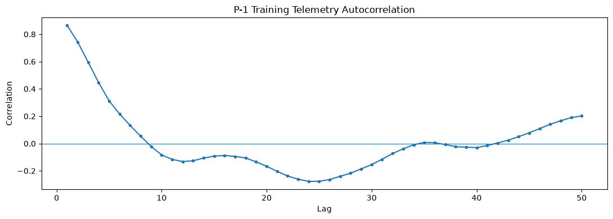
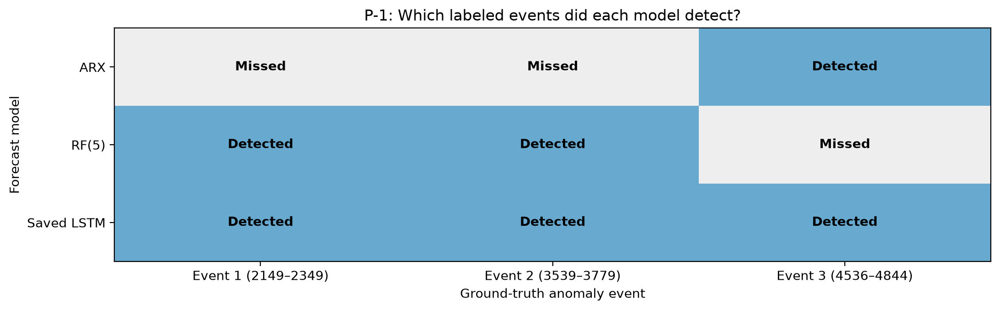
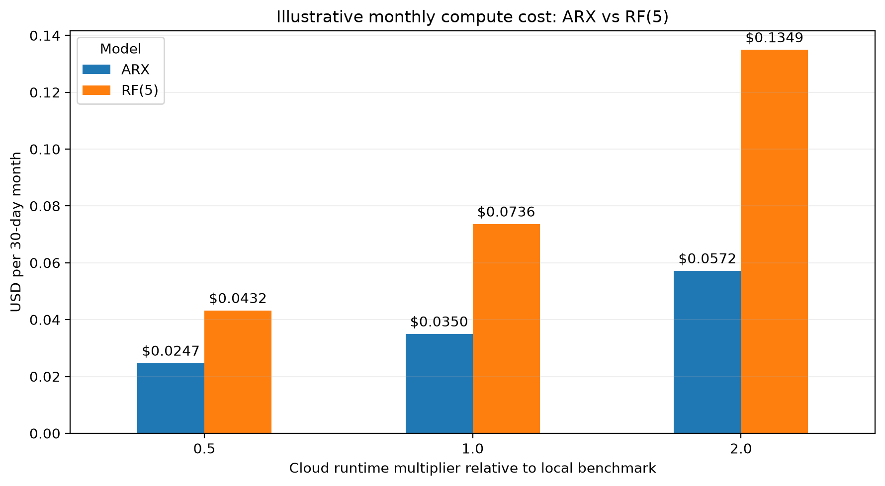

# Spacecraft Anomaly Detection: Statistical and Machine-Learning Approaches

**Fall 2026 Erdős Institute Data Science Boot Camp — Team Project**

**Team:** Diego Rios · Juan Orellana · Rithwik Susheel Vidyarthi · Henry Fontana · Jezerca Hodaj

> **Research question:** How do simple statistical methods, forecasting models, and direct anomaly detectors compare at identifying unusual spacecraft telemetry, particularly when we consider false alarms and computational cost?

## Project overview

Spacecraft continuously transmit telemetry describing the operation of onboard systems. Detecting unusual readings early can help engineers identify potential issues, but false alarms can overwhelm monitoring teams. We investigate anomaly detection on NASA spacecraft telemetry with an emphasis on the **P-1 power-channel data**.

Building on the published LSTM-based **Telemanom** approach, we explore a range of statistical and machine-learning alternatives: naive and rolling-average forecasting, Ridge regression, autoregressive regression with exogenous inputs (ARX), K-nearest neighbors (KNN), Random Forest forecasting, statistical anomaly baselines, and One-Class SVM. We examine the trade-offs among **forecast accuracy, anomaly-event detection, false alarms, and estimated computing cost**.

### What our team adds

Rather than retraining the original LSTM, we investigate multiple alternative approaches on P-1, compare selected forecast-based models with **saved LSTM reference predictions**, evaluate labeled anomaly-event coverage, and estimate the computational cost of running models under explicit illustrative workload assumptions. We also **reproduce and inspect the original Telemanom detection procedure**, implement shared detection examples, and examine exploratory unsupervised approaches such as Isolation Forest. Those exploratory studies are documented separately from the main model comparisons.

## Data

The original Telemanom dataset contains anonymized, pre-scaled telemetry from NASA's Soil Moisture Active Passive (SMAP) mission and Mars Science Laboratory (MSL) rover. We focus primarily on the **P-1** channel, whose arrays contain a telemetry variable and **24 contextual/command indicator features**. The training portion is treated as normal-operation data; the test portion contains expert-labeled anomaly intervals.

The three labeled P-1 test events are:

| Event | Test index interval |
|:---:|:---|
| 1 | 2149–2349 |
| 2 | 3539–3779 |
| 3 | 4536–4844 |

**Data source:** [Original Telemanom repository and data instructions](https://github.com/khundman/telemanom). See the original paper in [References](#references-and-attribution).

## Exploratory data analysis

We examined the P-1 telemetry series, labeled anomaly windows, temporal autocorrelation, telemetry–context correlations, and relationships among contextual indicators. In the normal training data, **lag-one telemetry autocorrelation was approximately 0.865**, suggesting strong short-term persistence. Some context variables also correlate with telemetry, motivating approaches that use both historical telemetry and contextual inputs.



*Interpretation note:* Pairwise correlation measures association, not causation, and does not by itself demonstrate predictive benefit.

### Additional EDA and method-development notebooks

The `EDA_Results/` directory contains **more than EDA**: it also includes examples of the anomaly-detection pipeline, reproductions of reference behavior, and early experiments. They serve different purposes:

| Notebook | What it investigates | Role in this project |
|---|---|---|
| [`EDA.ipynb`](EDA_Results/EDA.ipynb) | Survey of SMAP/MSL anomaly labels and channels; P-1 telemetry, command-feature activity, autocorrelation, plots around anomaly intervals, and preliminary model ideas | Initial EDA |
| [`Rios_EDA.ipynb`](EDA_Results/Rios_EDA.ipynb) | Dataset structure and labels, channel visualizations (including P-1 and D-14), plus early Isolation Forest examples | Dataset-wide EDA and exploratory experiments |
| [`Hodaj_P1_EDA_Correlation.ipynb`](EDA_Results/Hodaj_P1_EDA_Correlation.ipynb) | P-1 telemetry autocorrelation and telemetry–context/context–context correlations | Feature and lag exploration |
| [`Hodaj_P1_Statistical_Baselines.ipynb`](EDA_Results/Hodaj_P1_Statistical_Baselines.ipynb) | Global/rolling z-score, empirical-rank, and robust median/MAD detectors evaluated against P-1 labeled events | Statistical detection baselines |
| [`Detection_Module_UsageExamples.ipynb`](EDA_Results/Detection_Module_UsageExamples.ipynb) | Worked examples of passing **existing predictions** to the shared `detection.py` module, converting errors to anomaly intervals, and evaluating those intervals | Detector usage and scoring examples |
| [`Rios_Telemon_P1_Reproduction.ipynb`](EDA_Results/Rios_Telemon_P1_Reproduction.ipynb) | Step-by-step reproduction of Telemanom's saved P-1 predictions, error smoothing, dynamic thresholding, buffering, and pruning | Reference-method reproduction |
| [`Rios_Isolation_Forest_P1.ipynb`](EDA_Results/Rios_Isolation_Forest_P1.ipynb) | Isolation Forest fitted to normal telemetry, comparing current-value-only and history/rolling-feature representations | Exploratory unsupervised modeling |

The exploratory Isolation Forest analysis uncovered challenges with certain channels. For example, the D-14 training telemetry inspected in `Rios_EDA.ipynb` was constant, offering little variation for an Isolation Forest to partition; a preliminary P-1 test flagged many readings outside the labeled events. In `Rios_Isolation_Forest_P1.ipynb`, adding lagged and rolling features changed the anomaly scores but did not clearly resolve detection of extended flat periods. These are **investigations rather than final, comparable event-level benchmarks**.

The Telemanom reproduction is particularly useful for interpreting our LSTM reference. The original *historical saved report* listed **2 true-positive events, 1 false alert, and 1 missed event** on P-1. Re-running saved LSTM predictions with the **corrected pruning-index behavior** documented in the original authors' newer implementation produced **3 detected events, 1 false alert, and 0 missed events**. The reproduction notebook explores the historical indexing offset to explain this discrepancy; **we do not claim that correction as a new algorithm developed by our team**. See the [reproduction notebook](EDA_Results/Rios_Telemon_P1_Reproduction.ipynb) and [usage examples](EDA_Results/Detection_Module_UsageExamples.ipynb).

## Modeling approaches

| Family | Methods explored | Rationale |
|---|---|---|
| Simple forecasting baselines | Naive (previous-value) forecast; rolling-average forecast | Establish simple performance benchmarks |
| Linear forecasting | Ridge regression; linear regression; ARX(1) | Model recent telemetry and, where applicable, context features |
| Nonlinear forecasting | KNN; Random Forest (two separate implementations) | Capture nonlinear patterns beyond linear forecasts |
| Direct unsupervised anomaly detection | One-Class SVM; exploratory Isolation Forest | Identify unusual patterns without forecasting the next reading |
| Direct statistical baselines | Global z-score; empirical rank; rolling z-score; robust z-score; rolling median/MAD | Test interpretable threshold-based methods |
| Exploratory classification | Random Forest classifier | Investigate labeled-anomaly classification and its limitations |
| External reference | Published LSTM predictions from Telemanom | Compare selected methods with the original forecasting-based approach |

Most forecasting approaches predict telemetry first, then flag anomalous behavior using a separate error-based detector. The shared [`detection.py`](detection.py) module performs this alert-generation step; [`Detection_Module_UsageExamples.ipynb`](EDA_Results/Detection_Module_UsageExamples.ipynb) demonstrates it using existing LSTM predictions. Other methods, such as One-Class SVM, Isolation Forest, and telemetry-only statistical baselines, detect unusual observations more directly. **These approaches do not all share identical evaluation pipelines**; comparisons should be interpreted with that distinction in mind.

**Not every attempted method appears in the final event-level table.** Some notebooks are demonstrations or exploratory analyses without directly comparable event-level counts; their inclusion records what was investigated, not a validated performance ranking.

## Results and interpretation

### P-1 event detection: selected results

The following table illustrates event-level findings for selected models. **Event detection** means that at least one predicted alert overlaps the corresponding labeled interval; a false alert is an alert interval that overlaps no labeled event. These are not point-by-point classification metrics.

| Method | Labeled events detected (of 3) | Unmatched alert intervals | Event-level F1 |
|---|---:|---:|---:|
| Naive + Telemanom detector | 1 | 0 | 0.50 |
| Ridge + Telemanom detector | 1 | 0 | 0.50 |
| ARX(1) + Telemanom detector | 1 | 0 | 0.50 |
| Random Forest (5 lags) + Telemanom detector | 2 | 0 | 0.80 |
| KNN + Telemanom detector | 2 | 0 | 0.80 |
| Random Forest (250 steps) + Telemanom detector | 2 | 1 | 0.67 |
| Saved LSTM reference + corrected Telemanom detector | 3 | 1 | 0.86 |
| One-Class SVM | 3 | 2 | 0.75 |
| Rolling median/MAD (60), telemetry-only baseline* | 3 | 0 | 1.00 |

\* **Exploratory finding:** The 60-point window was investigated using the P-1 labeled test data. The rolling median/MAD baseline generated **19 alert intervals** across the three labeled events; the event-level score does not penalize repeated alerts within one event. This result does **not** establish performance on unseen channels or independently selected test events.



**Important:** The event-detection heatmap above is the **ARX/RF(5)/LSTM comparison**. The separate rolling median/MAD statistics were produced in the statistical-baselines notebook, not by applying MAD to the Random Forest predictions. The LSTM row uses the **corrected detection procedure applied to saved LSTM forecasts**, not the older historical result (see [method reproduction](EDA_Results/Rios_Telemon_P1_Reproduction.ipynb)).

### What we learned

- Some models produce **no unmatched alerts but miss real events**: for example, ARX(1) has 100% event-level precision but detects only one of the three labeled events.
- Better forecasting accuracy does not automatically imply better anomaly-event detection.
- Direct statistical methods can be competitive on this P-1 example, but tuning and limited event counts make independent validation essential.
- False alarms, event coverage, and computational demand should be considered together rather than relying on a single score.

The team evaluated additional models in their respective notebooks. Do not interpret the selected table as a fully controlled ranking across every notebook: feature sets, alert construction, calibration, and scoring conventions differ in some analyses.

## Computational cost

We benchmarked model runtimes locally and used **illustrative AWS pricing/workload assumptions** to estimate cloud processing expenses. The calculations distinguish forecast generation (or classification/inference) from anomaly-detection processing where those stages are available. They are **scenario estimates, not measured AWS bills**; overhead, hardware, workload, and detector implementation can materially affect them.



The figure above compares **ARX(1) and Random Forest (5 lags)** in the local comparison notebook. Other cost analyses are available in the team's model/cost notebooks and should not be assumed to share identical assumptions without checking them.

## Repository structure

The outline below highlights the main analysis and result locations. The `EDA_Results/` folder includes both exploratory analysis and supporting detector/method experiments. Some data are **downloaded separately** and may not be committed to GitHub; paths should be checked against the published repository and the relevant notebook before running.

```text
fall-2026-spacecraft-sensors/
├── EDA_Results/
│   ├── EDA.ipynb                         # Initial SMAP/MSL and P-1 EDA
│   ├── Rios_EDA.ipynb                    # Dataset exploration + early Isolation Forest
│   ├── Hodaj_P1_EDA_Correlation.ipynb    # Autocorrelation and context associations
│   ├── Hodaj_P1_Statistical_Baselines.ipynb
│   ├── Detection_Module_UsageExamples.ipynb
│   ├── Rios_Telemon_P1_Reproduction.ipynb
│   └── Rios_Isolation_Forest_P1.ipynb
├── Models/
│   ├── Hodaj_AR_exogenous.ipynb
│   ├── Hodaj_Random_Forest_lag5.ipynb
│   ├── Hodaj_P1_ARX_RF_LSTM_Comparison.ipynb
│   ├── Rolling_Average_Forecast.ipynb
│   ├── SVM.ipynb
│   ├── SVM_Cost_Analysis.ipynb
│   └── ...                              # Other team model/cost notebooks
├── figures/                             # Figures for the report/presentation
├── results/
│   └── hodaj_p1_model_comparison/       # Exported prediction arrays, metrics, plots
├── detection.py                        # Shared error-to-alert detector
├── README.md
└── data/ (if downloaded locally)       # P-1 train/test arrays, labels, LSTM reference files
```

The individual model notebooks are the primary record of model construction, parameter choices, and outputs; the comparison notebooks consolidate compatible results. The exact data-directory layout depends on how the original Telemanom data have been downloaded.

## Reproducing results

1. **Clone the repository:**

   ```bash
   git clone https://github.com/Erdos-Projects/fall-2026-spacecraft-sensors.git
   cd fall-2026-spacecraft-sensors
   ```

2. **Prepare a Python/Jupyter environment.** Common packages include `numpy`, `pandas`, `scipy`, `scikit-learn`, `matplotlib`, `seaborn`, and `statsmodels`; individual notebooks may require additional dependencies. Consult a team-maintained `requirements.txt` if one is provided.
3. **Make the original data available** at the paths expected by the notebooks, especially `data/data/train/P-1.npy`, `data/data/test/P-1.npy`, and `data/data/labeled_anomalies.csv`. The published LSTM comparison additionally needs the original saved LSTM predictions. Consult the [Telemanom dataset instructions](https://github.com/khundman/telemanom).
4. **Explore the data and reference detector (optional but useful):** start with the notebooks listed in [Additional EDA and method-development notebooks](#additional-eda-and-method-development-notebooks). `Rios_Telemon_P1_Reproduction.ipynb` explains the Telemanom detection steps and `Detection_Module_UsageExamples.ipynb` demonstrates their use with saved predictions. These are **not required to retrain the LSTM**.
5. **Run individual model notebooks** in Jupyter, preferably from the repository root or the `Models/` folder as supported by each notebook.
6. **For the ARX/RF/LSTM comparison:** first run the ARX and RF notebooks through their export sections, which produce files such as `results/hodaj_p1_model_comparison/arx_results.npz` and `rf5_results.npz`. Then run [`Hodaj_P1_ARX_RF_LSTM_Comparison.ipynb`](Models/Hodaj_P1_ARX_RF_LSTM_Comparison.ipynb). The comparison notebook uses saved LSTM forecasts rather than retraining that reference model.
7. **Review results:** summary `.csv` tables and figures appear in `results/` and/or `figures/`. Some output tables and images are committed so that reviewers can inspect them without rerunning expensive notebooks.

> **Reproducibility note:** Execution time and cost estimates depend on hardware and environment. The included example outputs represent runs conducted by the project team; exact numerical results can vary with library versions, random seeds, and runtime conditions.

## Limitations and future directions

- **Scope:** Most detailed analysis focuses on a single P-1 channel with just three labeled anomaly events; results may not generalize to other channels or anomaly types.
- **Comparability:** Models use some different input windows, detection rules, or evaluation details. Isolation Forest explorations, detector demonstrations, and selected forecasting experiments should not be placed in a single ranking without harmonizing event-level scoring. A more controlled benchmark would hold these choices fixed where scientifically appropriate.
- **Threshold selection:** Some anomaly thresholds or window lengths were explored on labeled P-1 test results, potentially producing optimistic performance estimates.
- **Evaluation:** Event-overlap metrics do not fully reflect how early an anomaly is detected, how much of an interval is covered, or repeated alerts within the same event.
- **Next steps:** Evaluate across additional channels (including near-constant channels), calibrate thresholds on independent normal-validation data, compare detection latency and alert burden, test features specifically designed to capture sustained flatness, strengthen feature engineering, and benchmark inference cost on a common deployment environment.

## Presentation and other deliverables

- **Five-minute presentation:** [Add recording URL when published](#)
- **Executive summary:** [Add file or URL when available](#)
- **Notebook outputs:** See [`figures/`](figures/) and [`results/`](results/).

## References and attribution

Hundman, K., Constantinou, V., Laporte, C., Colwell, I., & Soderstrom, T. (2018). **Detecting Spacecraft Anomalies Using LSTMs and Nonparametric Dynamic Thresholding**. *Proceedings of KDD 2018*. [Paper (arXiv)](https://arxiv.org/abs/1802.04431) · [Original Telemanom code and dataset instructions](https://github.com/khundman/telemanom).

The original Telemanom repository and underlying spacecraft dataset belong to their respective authors and providers. Our work is a student-team comparative analysis; it should not be interpreted as a NASA-endorsed operational detector.
